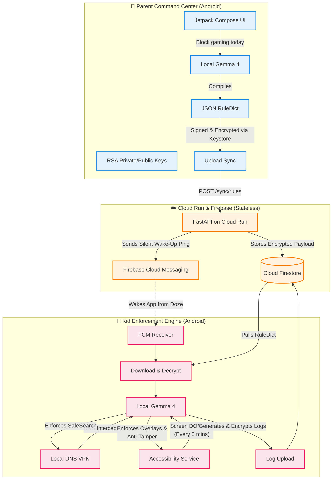

Here is a complete, polished `README.md` for **Umbrella**. You can drop this directly into your GitHub repository or project documentation. It includes the architectural Mermaid diagrams and a breakdown of the technical stack.

***

# ☂️ Umbrella: Privacy-First AI Parental Control

[](#)
[](#)
[](#)

**Umbrella** is a next-generation, End-to-End Encrypted (E2EE) parental control system powered entirely by local Small Language Models (SLMs). 

Built specifically for Android, Umbrella replaces invasive, subscription-heavy, cloud-reliant parental control apps. By leveraging **Gemma 4** running locally on the device, Umbrella can contextually analyze screen content, enforce dynamic rules, and protect children—all without sending a single byte of raw personal data to third-party servers.

---

## ✨ Core Philosophy & Features

*   **Zero-Knowledge & E2EE:** The cloud acts purely as a stateless mailbox. Rule dictionaries and activity logs are encrypted locally via RSA keypairs exchanged via QR code.
*   **Contextual SLM (Gemma 4):** Standard apps block domains statically. Umbrella uses AI to read the *context* of a screen. (e.g., *Is this a harmless biology video or inappropriate content?*)
*   **Battery-Conscious Lifecycle:** AI inference only runs on a strict 5-minute interval or during specific trigger events (new app opened). Gemma unloads from RAM when the screen turns off.
*   **Dual-Layer Enforcement:**
    *   **Local DNS VPN:** Silently forces SafeSearch and blocks internet access to forbidden domains.
    *   **Accessibility Services:** Reads screen content and instantly overlays un-closeable blocks if explicit content, severe cyberbullying, or tampering is detected.
*   **Zero Subscriptions:** Bring your own GCP/Firebase free tier. No monthly fees.

---

## 🏗️ Architecture & Data Flow

Umbrella is split into three components: **Parent Command Center**, **Cloud Relay**, and the **Kid Enforcement Engine**. 



---

## 🛠️ Technical Stack

### 1. Parent & Kid Android Apps (Frontend & Local AI)
*   **Language & UI:** Kotlin, Jetpack Compose.
*   **Local LLM Integration:** [MediaPipe LLM Inference API](https://developers.google.com/mediapipe/solutions/genai/llm_inference) / `llama.cpp` for Android.
*   **Model:** Google Gemma 4 (4-bit Integer Quantized, ~2B-4B parameter configuration).
*   **Cryptography:** Android Keystore API (RSA-2048 for key generation, signing, and payload encryption).
*   **System APIs (Kid App):** `VpnService` (DNS Sinkhole), `AccessibilityService` (Screen Reading & UI Overlays), `CameraX` (QR Handshake).

### 2. Cloud Relay (Backend)
*   **Compute:** Google Cloud Run.
*   **Backend Framework:** Python (FastAPI).
*   **Database:** Firebase Cloud Firestore (NoSQL, storing E2EE blobs).
*   **Push Notifications:** Firebase Cloud Messaging (FCM) for high-priority silent wakes.

---

## ⚙️ How It Works (The Lifecycle)

1.  **The Handshake:** The parent downloads the app, generates an RSA keypair, and displays a QR code. The kid's phone scans the QR code, securely storing the `family_id` and Parent's Public Key via `EncryptedSharedPreferences`.
2.  **Rule Generation:** The parent types a natural language command *(e.g., "No social media during school hours")*. The Parent's local Gemma translates this into a strict JSON `RuleDict`.
3.  **Syncing:** The Parent app encrypts the `RuleDict` and pushes it to Cloud Run. Cloud Run pings the Kid's phone via FCM. The Kid's phone wakes up, downloads, and applies the new rules.
4.  **Enforcement (The 5-Minute Loop):** 
    *   While the kid's screen is ON, Gemma loads into RAM.
    *   Every 5 minutes, `AccessibilityService` scrapes the screen text.
    *   Gemma evaluates the text against the `RuleDict`.
    *   If a violation occurs, `AccessibilityService` draws an un-closeable warning overlay.
5.  **Logging:** Gemma summarizes the 5-minute chunks, encrypts the summary using the Parent's Public Key, and uploads it to Firestore. 
6.  **Sleep Mode:** When the screen turns off (`ACTION_SCREEN_OFF`), Gemma unloads to conserve battery. Network blocks are maintained by the ultra-lightweight VPN.

---

## 📱 Minimum Device Requirements (Kid's Phone)

Because the Kid's device runs an AI model locally in the background, modern hardware is required to prevent overheating and battery drain.

*   **Operating System:** Android 11+ (API Level 30+). iOS is not supported due to system restrictions.
*   **RAM:** 6GB Minimum (8GB Highly Recommended).
*   **Chipset:** Snapdragon 8 Gen 1, Google Tensor G2, MediaTek Dimensity 8100, or newer (A dedicated NPU/strong GPU is required).
*   **Storage:** 4GB free space for model weights and encrypted logs.

---

## 🔒 Security & Anti-Tamper Mechanisms

*   **No Third-Party Access:** Because logs are encrypted with a Private Key held *only* on the Parent's physical device, neither developers, Google, nor hackers can read the kid's screen activity.
*   **Settings Shield:** If a child attempts to open Android Settings to disable the VPN or Accessibility permissions, Umbrella detects the UI state and instantly forces the "Back" action, requiring a Parent PIN to proceed.

---

## 🚀 Getting Started (Developers)

*Instructions for building the project locally will go here based on your repository structure. Provide commands for Dockerizing the Cloud Run FastAPI and building the Android `.apk` files.*

```bash
# Example: Deploying the Cloud Relay
cd umbrella-cloud
gcloud run deploy umbrella-relay --source . --region us-central1 --allow-unauthenticated
```
